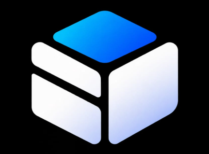

<div align="center">

  

  # ONEBOX
  **Espace numérique personnel pour capturer, organiser et retrouver ses informations.**

  [](LICENSE)
  [](#principes-directeurs)
  [](#architecture-technique)
  [](#qualité--tests)
  [](#principes-directeurs)

  *« Tu enregistres une information une seule fois. ONEBOX t'aide à la retrouver quand tu en as besoin. »*

</div>

---

## 🎯 Vision & Principes Directeurs (Cahier des Charges v1.0)

ONEBOX est un logiciel open source conçu pour centraliser vos notes, liens web, documents et images dans un espace sécurisé, souverain et indépendant de tout service cloud ou IA obligatoire.

- 🔒 **100% Local-First** : Vos données restent stockées exclusivement sur votre ordinateur (`data/onebox.db` et `data/attachments/`). Aucun compte, aucun abonnement requis.
- ⚡ **Capture en moins de 10s** : Interface épurée à 3 colonnes avec prise de notes instantanée en Markdown riche, sauvegarde d'URL avec métadonnées auto et import de documents par glisser-déposer.
- 🔍 **Recherche Plein Texte FTS5** : Moteur de recherche ultra-rapide avec tolérance aux accents et minuscules (`unicode61 remove_diacritics 2`), affichage des extraits en surbrillance.
- 🏷️ **Organisation Multi-Tags** : Étiquettes avec pastilles de couleur, filtrage combinatoire et vue dédiée pour les éléments non classés.
- 📦 **Export & Maîtrise Ouverte** : Exportation en un clic en archive ZIP avec manifeste d'intégrité SHA-256, dump JSON et fichiers bruts. Restauration fidèle testée.

---

## 💻 Raccourcis Clavier

| Raccourci | Action |
| :--- | :--- |
| **`Ctrl + N`** | Créer instantanément une nouvelle note |
| **`Ctrl + K`** ou **`Ctrl + P`** | Ouvrir la palette de commandes et recherche rapide |
| **`Ctrl + D`** | Dupliquer l'élément actif |
| **`Ctrl + \`** | Masquer / Afficher le panneau latéral |
| **`↑` / `↓`** | Parcourir les notes de la liste au clavier |
| **`Suppr`** | Déplacer l'élément sélectionné dans la corbeille |
| **`Échap`** | Fermer les modales et palettes |

---

## 📂 Structure du Répertoire (Section 15.2)

```
onebox/
├── apps/
│   └── desktop/                 # Serveur HTTP local & Interface Web SPA
├── packages/
│   ├── core/                    # Types du domaine, validations et dictionnaires i18n
│   ├── data/                    # Persistance SQLite, migrations versionnées & FTS5
│   ├── storage/                 # Gestionnaire de fichiers, intégrité SHA-256 et export ZIP
│   └── search/                  # Moteur de recherche plein texte et filtres
├── docs/                        # Architecture, ADRs, Guides utilisateur et développeur
├── test/                        # Suite de tests automatisés (Critères AC-01 à AC-12)
├── start-onebox.bat             # Lanceur 1-clic pour Windows
└── .github/workflows/ci.yml     # Pipeline d'intégration continue GitHub Actions
```

---

## 🚀 Démarrage Rapide

### Prérequis
- [Node.js](https://nodejs.org/) v20+ ou v24+ (aucun compilateur externe C++ requis).

### Lancement
Sur Windows, double-cliquez simplement sur **`start-onebox.bat`**, ou lancez en ligne de commande :

```powershell
# 1. Démarrer le serveur
npm start

# 2. Ouvrir l'application dans votre navigateur :
# http://localhost:3845
```

---

## 🧪 Tests Automatisés

Le projet comprend une suite complète validant l'ensemble des critères d'acceptation du cahier des charges :

```powershell
npm test
```

```
▶ ONEBOX Suite Complète - Critères d'acceptation MVP
  ✔ AC-01 & AC-02: Création et persistance locale d'une note sans compte
  ✔ AC-03: Sauvegarde d'un lien et recherche par mot-clé
  ✔ AC-04: Import de fichier avec nom, taille, checksum et type MIME
  ✔ AC-05: Gestion des tags, multi-tagging et filtrage
  ✔ AC-06: Suppression réversible (corbeille) et restauration
  ✔ AC-07: Export ZIP avec données complètes et manifeste d'intégrité
  ✔ AC-08: Consultation et recherche locales 100% hors-ligne
  ✔ AC-09: Validation stricte des entrées et gestion d'erreurs claires
  ✔ AC-10: Migrations de base et intégrité des données existantes
  ✔ AC-11: Importation et restauration d'une sauvegarde
  ✔ AC-12: Duplication native et vidage de la corbeille
✔ 12 pass / 0 fail
```

---

## 📄 Licence

Ce projet est sous licence **Apache 2.0**. Vos données vous appartiennent en totalité.
