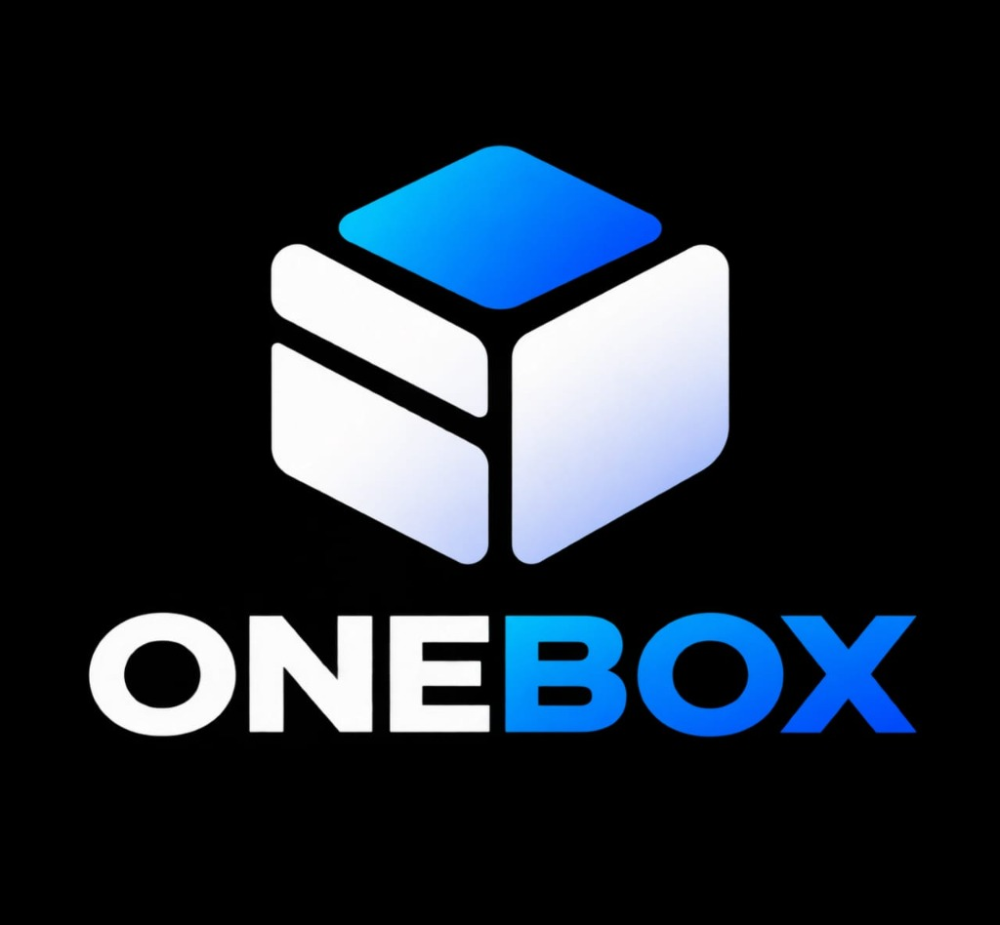

# Guide Utilisateur — ONEBOX

Bienvenue dans **ONEBOX**, votre espace numérique personnel pensé pour capturer, organiser et retrouver vos informations en toute simplicité et confidentialité.

## 1. Principes essentiels

- **Capture immédiate** : Enregistrez une note, un lien web ou un document en moins de 10 secondes.
- **Stockage 100% local** : Vos données restent sur votre ordinateur. Aucun serveur distant, aucun abonnement, aucune publicité.
- **Recherche instantanée** : Retrouvez vos informations par mot-clé, tags ou type en tapant simplement `Ctrl + K`.

---

## 2. Prendre en main l'application

### A. Ajouter un élément (3 boutons visibles en permanence)
1. **Ajouter une note** (`+ Note`) :
   - Saisissez un titre et votre texte (supporte la syntaxe Markdown).
   - Associez éventuellement des tags (ex: `#Travail`, `#Idées`).
   - Cliquez sur **Enregistrer**.
2. **Sauvegarder un lien** (`+ Lien`) :
   - Collez l'URL de votre article, vidéo ou outil.
   - Ajoutez une brève note explicative et des tags.
3. **Importer un fichier ou une image** (`+ Fichier / Image`) :
   - Glissez-déposez ou sélectionnez votre fichier.
   - L'application calcule une empreinte d'intégrité **SHA-256** et conserve une copie sécurisée.

### B. Organiser avec les tags
- Dans la colonne de gauche, cliquez sur `+ Nouveau` dans la section **Étiquettes / Tags**.
- Cliquez sur un tag pour filtrer instantanément tous les éléments associés.
- Les éléments sans étiquette sont regroupés sous la vue **Non classés**.

### C. Recherche rapide
- Appuyez sur **`Ctrl + K`** pour placer le curseur dans la barre de recherche.
- Tapez un ou plusieurs mots : la recherche plein texte SQLite FTS5 s'exécute en direct sur les titres, le contenu des notes et les tags.

### D. Corbeille et suppression réversible
- Cliquez sur l'icône de corbeille d'un élément pour le retirer de votre boîte de réception.
- Dans la section **Corbeille**, vous pouvez :
  - **Restaurer** l'élément à tout moment.
  - **Supprimer définitivement** après confirmation explicite.

### E. Sauvegarder et Exporter vos données
- Cliquez sur **Sauvegarder / Exporter** dans la colonne latérale.
- ONEBOX génère instantanément une archive `.zip` contenant :
  - `manifest.json` : manifeste avec empreintes de vérification.
  - `items.json` & `items.csv` : vos métadonnées complètes.
  - `notes/` : toutes vos notes exportées en fichiers `.md`.
  - `attachments/` : vos documents et images d'origine.

